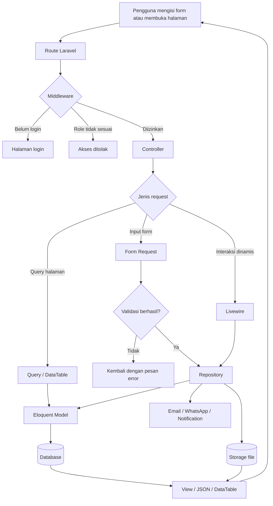
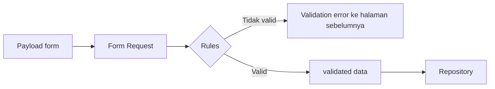
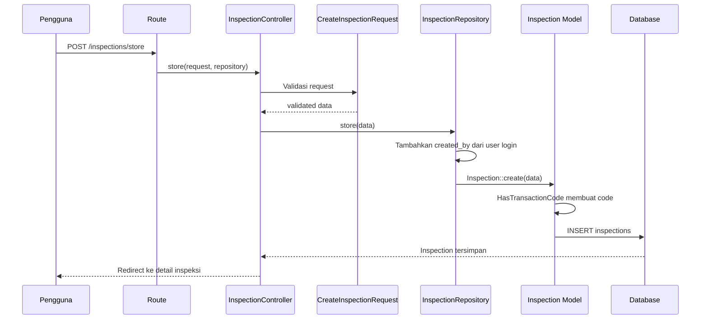
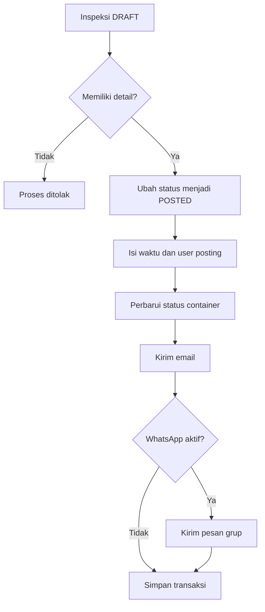
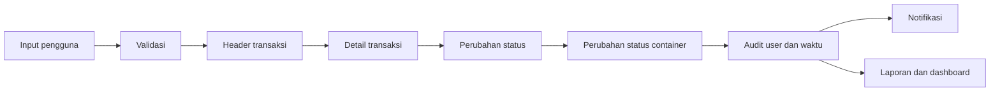

# Alur Data Baracoal CMS

## 1. Tujuan Dokumen

Dokumen ini menjelaskan bagaimana data diproses, divalidasi, diubah, dan disimpan pada Baracoal CMS. Penjelasan mencakup alur request dari browser sampai database, pola transaksi operasional, relasi data utama, penyimpanan file, serta proses notifikasi.

Baracoal CMS menggunakan Laravel 8 dengan pola:

```text
Browser
  -> Route dan Middleware
  -> Controller
  -> Form Request
  -> Repository
  -> Eloquent Model
  -> Database
```

Komponen yang berhubungan dengan alur data:

- Route: [`routes/admin.php`](routes/admin.php), [`routes/web.php`](routes/web.php), dan [`routes/api.php`](routes/api.php).
- Controller: [`app/Http/Controllers/Console/`](app/Http/Controllers/Console/).
- Validasi: [`app/Http/Requests/`](app/Http/Requests/).
- Repository: [`app/Repositories/Console/`](app/Repositories/Console/).
- Model: [`app/Models/`](app/Models/).
- Migration database: [`database/migrations/`](database/migrations/).
- Livewire: [`app/Http/Livewire/`](app/Http/Livewire/).

## 2. Gambaran Alur Data



## 3. Tahapan Pemrosesan Data

### 3.1 Request masuk melalui route

Pengguna mengakses URL atau mengirim form. Route menentukan controller dan method yang harus dijalankan. Sebagian besar operasi internal berada pada route console di [`routes/admin.php`](routes/admin.php).

Contoh pola route:

```php
Route::post('/inspections/store', [InspectionController::class, 'store']);
```

Route juga dapat menggunakan:

- `auth:admin` untuk memastikan pengguna sudah login.
- `role:...` untuk membatasi role.
- Route model binding, misalnya `{inspection}`, `{container}`, atau `{contract}`, agar record model dapat diambil otomatis berdasarkan parameter URL.

### 3.2 Middleware memeriksa akses

Sebelum controller dijalankan, middleware memeriksa:

1. Apakah pengguna memiliki sesi admin yang valid.
2. Apakah role pengguna diizinkan mengakses endpoint.
3. Apakah parameter model yang diminta tersedia.

Jika pemeriksaan gagal, proses berhenti sebelum data diproses oleh repository.

### 3.3 Controller menerima dan mengarahkan data

Controller bertugas mengatur alur, bukan menjadi tempat utama query bisnis. Contoh pada [`InspectionController.php`](app/Http/Controllers/Console/InspectionController.php):

1. `store()` menerima `CreateInspectionRequest`.
2. Controller mengambil hasil `$request->validated()`.
3. Data dikirim ke `InspectionRepository::store()`.
4. Setelah berhasil, pengguna diarahkan ke halaman detail inspeksi.

Untuk operasi baca, controller dapat mengembalikan view atau DataTable. Untuk operasi perubahan, controller biasanya mengembalikan redirect dengan pesan sukses atau error.

### 3.4 Form Request memvalidasi input

File pada [`app/Http/Requests/`](app/Http/Requests/) mendefinisikan aturan input untuk create dan update. Data yang diteruskan ke repository seharusnya berasal dari `validated()`, bukan seluruh payload mentah.

Alur validasi:



Dengan pola ini, data yang belum memenuhi format, tipe, atau hubungan yang dipersyaratkan ditolak sebelum masuk ke database.

### 3.5 Repository menjalankan aturan bisnis

Repository pada [`app/Repositories/Console/`](app/Repositories/Console/) memproses data yang sudah tervalidasi. Tanggung jawabnya meliputi:

- Membuat, mengubah, dan menghapus record.
- Menjalankan query DataTables dan laporan.
- Mengubah status transaksi.
- Memperbarui record terkait, misalnya status container.
- Membuka transaksi database saat beberapa perubahan harus berhasil bersama.
- Mengirim notifikasi setelah kondisi bisnis terpenuhi.

Controller memanggil repository, sedangkan repository menggunakan model Eloquent untuk berinteraksi dengan database.

### 3.6 Model menyimpan data melalui Eloquent

Model pada [`app/Models/`](app/Models/) merepresentasikan tabel database dan relasinya. Model dapat menentukan:

- Nama dan atribut data.
- Relasi `belongsTo`, `hasMany`, atau relasi lain.
- Casting, misalnya kolom JSON menjadi array PHP.
- Soft delete.
- Event model untuk pembuatan kode transaksi.

Contohnya, [`Inspection.php`](app/Models/Inspection.php) memiliki relasi `details()` ke `InspectionDetail`, sedangkan [`InspectionDetail.php`](app/Models/InspectionDetail.php) memiliki relasi ke `Inspection` dan `Container`.

## 4. Contoh Detail: Alur Data Inspeksi

### 4.1 Membuat header inspeksi



Repository [`InspectionRepository.php`](app/Repositories/Console/InspectionRepository.php) menambahkan `created_by` dari user yang sedang login. Model `Inspection` menggunakan trait [`HasTransactionCode.php`](app/Traits/HasTransactionCode.php), sehingga kode transaksi dibuat saat event `creating` dijalankan. Format kode dibentuk dari nomor urut, prefix transaksi, kode lokasi, dan tahun.

### 4.2 Menyimpan detail inspeksi

Header inspeksi disimpan pada tabel `inspections`. Detail container disimpan terpisah pada `inspection_details` dan dihubungkan dengan `inspection_id`.

Relasi utamanya:

```text
inspections
    1 ──────── banyak
inspection_details
    banyak ─── 1
containers
```

Kolom penting detail:

- `inspection_id`: hubungan ke header inspeksi.
- `container_code`: hubungan ke container berdasarkan kode.
- `damage_description`: uraian kerusakan.
- `damage_cause_description`: uraian penyebab.
- `root_cause`: akar masalah.
- `images`: data JSON berisi referensi gambar.

Jika header inspeksi dihapus, detail terkait ikut terhapus karena foreign key menggunakan `onDelete('cascade')`.

### 4.3 Posting inspeksi

Saat inspeksi di-posting, repository memeriksa:

1. Status harus `DRAFT`.
2. Inspeksi harus memiliki minimal satu detail.
3. Status header diubah menjadi `POSTED`.
4. `post_date`, `post_by`, dan `last_updated_by` diisi.
5. Status container pada detail diperbarui menjadi status proses inspeksi.
6. Notifikasi dikirim kepada supervisor melalui email.
7. Pesan dapat dikirim ke grup WhatsApp apabila konfigurasi WhatsApp aktif.



### 4.4 Approval dan reject

Pada approval, repository memastikan data wajib telah lengkap, termasuk jenis perbaikan dan root cause setiap detail. Setelah valid:

- `last_type_maintenance` pada container diperbarui.
- Status inspeksi menjadi `APPROVE`.
- `approve_date`, `approve_by`, dan `last_updated_by` diisi.
- Email persetujuan dikirim kepada pembuat inspeksi.

Pada reject, status inspeksi dikembalikan menjadi `DRAFT`, `last_updated_by` diperbarui, lalu email penolakan dikirim kepada pembuat inspeksi.

## 5. Penyimpanan Data di Database

### 5.1 Konfigurasi koneksi

Koneksi database didefinisikan pada [`config/database.php`](config/database.php) dan nilainya diambil dari environment. Default proyek menggunakan:

- Driver: `mysql`.
- Host: `DB_HOST`.
- Port: `DB_PORT`.
- Database: `DB_DATABASE`.
- Username: `DB_USERNAME`.
- Password: `DB_PASSWORD`.
- Charset: `utf8mb4`.
- Collation: `utf8mb4_unicode_ci`.

Nilai aktual harus disediakan pada file environment lokal dan tidak ditulis di dokumentasi atau source code.

### 5.2 Struktur tabel

Struktur tabel dibuat dan diubah oleh migration pada [`database/migrations/`](database/migrations/). Migration menyimpan riwayat perubahan skema dan menjadi sumber definisi untuk:

- Primary key.
- Foreign key.
- Index dan unique key.
- Tipe kolom.
- Default value.
- Soft delete.
- Cascade delete.

Domain utama yang disimpan meliputi:

| Domain | Contoh data |
|---|---|
| Master | Admin, company, location, unit, vendor, config. |
| Kontrak | Contract dan contract detail. |
| Container | Container, status, dokumen, dan record. |
| Inspeksi | Inspection dan inspection detail. |
| Aktivitas | Container daily activity dan detailnya. |
| Vendor | Delegation to vendor dan delegation from vendor beserta detail/sub-detail. |
| Tindak lanjut | Repair dan scrap beserta detailnya. |
| Sistem | Notifications, jobs, dan tabel bawaan Laravel lainnya. |

### 5.3 Status dan metadata audit

Transaksi memakai kolom status dan metadata proses. Pola umum yang digunakan:

```text
DRAFT -> POSTED -> APPROVE
                  \
                   -> REJECTED atau kembali ke DRAFT
```

Kolom audit yang umum:

- `created_by`: user pembuat.
- `last_updated_by`: user terakhir yang mengubah.
- `post_by` dan `post_date`: user dan waktu posting.
- `approve_by` dan `approve_date`: user dan waktu approval.
- `created_at` dan `updated_at`: timestamp Eloquent.
- `deleted_at`: timestamp soft delete jika model menggunakan `SoftDeletes`.

Tidak semua tabel memiliki seluruh kolom tersebut; detailnya mengikuti migration masing-masing.

### 5.4 Soft delete dan cascade

Model yang menggunakan `SoftDeletes`, seperti [`Inspection.php`](app/Models/Inspection.php), tidak langsung menghapus baris dari database ketika `delete()` dipanggil. Sistem mengisi `deleted_at`, sehingga data masih dapat dipulihkan atau ditelusuri melalui query yang menyertakan trashed records.

Sebaliknya, relasi detail yang menggunakan foreign key `onDelete('cascade')` dapat dihapus otomatis ketika header induknya benar-benar dihapus sesuai aturan database.

## 6. Penyimpanan File dan Gambar

Konfigurasi filesystem berada di [`config/filesystems.php`](config/filesystems.php), sedangkan default environment menggunakan filesystem `local`. File yang diunggah oleh modul operasional disimpan melalui Laravel Storage, bukan sebagai isi binary langsung di kolom transaksi.

Untuk detail inspeksi, kolom `images` bertipe JSON dan dicasting menjadi array pada model. Artinya:

```text
File gambar -> Storage
Referensi/path gambar -> inspection_details.images
```

Saat gambar ditampilkan atau dikirim dalam notifikasi, aplikasi membentuk URL storage menggunakan `Storage::url()`.

## 7. Data dari Livewire

Komponen Livewire pada [`app/Http/Livewire/`](app/Http/Livewire/) memproses interaksi tanpa reload penuh. Alurnya:

1. Browser mengubah field atau menekan tombol.
2. Livewire mengirim request ke komponen.
3. Method seperti `updated<Property>()`, `submit()`, `upload()`, atau `delete()` dijalankan.
4. Komponen memvalidasi atau meneruskan data ke model/repository.
5. Database dan/atau storage diperbarui.
6. State komponen dan tampilan dirender ulang.

Livewire digunakan untuk form detail, modal, upload, tabel detail, filter laporan, dashboard, dan proses interaktif lainnya.

## 8. Data Output dan Pembacaan

Data yang sudah tersimpan dibaca kembali melalui beberapa jalur:

- View Blade untuk halaman biasa.
- Livewire untuk tampilan interaktif.
- DataTables untuk tabel dengan pagination, pencarian, dan filter.
- Dashboard untuk agregasi status container.
- Export dan laporan BAST untuk output terstruktur.
- Notification dan email untuk pemberitahuan proses.

Repository atau DataTable biasanya menggunakan eager loading, misalnya relasi `location` dan `createdByUser`, agar data terkait dapat ditampilkan dengan lebih efisien.

## 9. Transaksi Database dan Konsistensi

Operasi yang mengubah beberapa record sekaligus menggunakan `DB::beginTransaction()` dan `DB::commit()`. Contohnya proses posting atau approval inspeksi yang sekaligus:

1. Mengubah status header.
2. Mengisi metadata audit.
3. Mengubah status container.
4. Mengirim atau menyiapkan notifikasi.

Jika proses gagal sebelum commit, aplikasi harus mempertahankan penanganan exception dan rollback sesuai implementasi transaksi agar perubahan tidak tersimpan sebagian. Controller pada beberapa operasi menangkap exception, mencatatnya dengan `Log`, dan mengembalikan pesan error ke pengguna.

## 10. Integrasi Eksternal

### Email

Email dikirim melalui class pada [`app/Mail/`](app/Mail/) ketika proses seperti inspeksi, progress, delegasi, repair, atau scrap mengalami perubahan status. Data transaksi digunakan untuk membentuk isi email.

### WhatsApp

Integrasi WhatsApp ditangani oleh [`WhatspieService.php`](app/Services/WhatspieService.php). Service menyediakan fungsi:

- Memulai session.
- Membaca status session.
- Mengakhiri session.
- Mengambil QR code.
- Mengirim pesan ke grup.

Credential, session, dan group dikonfigurasi melalui environment dan service configuration. Pesan WhatsApp bukan penyimpanan utama transaksi; database tetap menjadi sumber data operasional.

## 11. Ringkasan Siklus Hidup Data



Ringkasnya:

1. Data masuk melalui route, controller, atau Livewire.
2. Data divalidasi oleh Form Request atau validasi komponen.
3. Header dan detail disimpan pada tabel yang berbeda sesuai relasi.
4. Repository menjalankan aturan status dan perubahan data terkait.
5. User, tanggal, status, dan histori dicatat sebagai metadata proses.
6. File disimpan di Storage, sedangkan referensinya disimpan pada database.
7. Database menjadi sumber utama untuk dashboard, laporan, dan histori.
8. Email atau WhatsApp digunakan sebagai kanal pemberitahuan, bukan sebagai sumber penyimpanan utama.
