# CTC · Container Management System — Flowchart

Flowchart sistem `baracoal-cms` (Laravel 8 + SQL Server), disusun dari source code pada 4 November 2026.
Diagram memakai **Mermaid**, jadi bisa dibuka langsung di GitHub/GitLab, VS Code (ekstensi *Markdown Preview Mermaid Support*), Obsidian, atau mermaid.live.

Pendamping dokumen: `CMS_SYSTEM_OVERVIEW.png` (poster) dan `CMS_SYSTEM_GUIDE.pdf` (panduan lengkap).

**Singkatan path:**
`C/` = `app/Http/Controllers/Console/` · `R/` = `app/Repositories/Console/` · `L/` = `app/Http/Livewire/` · `M/` = `app/Models/`

## Daftar isi

1. [Arsitektur sistem](#1-arsitektur-sistem)
2. [Alur request (login → role → proses)](#2-alur-request)
3. [Alur proses end-to-end](#3-alur-proses-end-to-end)
4. [Status container (state diagram)](#4-status-container)
5. [Pola status transaksi](#5-pola-status-transaksi)
6. [BP-02 Aktivitas harian](#6-bp-02-aktivitas-harian)
7. [BP-03 Inspeksi](#7-bp-03-inspeksi)
8. [BP-04 BAST ke Vendor (BAST 1)](#8-bp-04-bast-ke-vendor-bast-1)
9. [BP-05 Progress perbaikan](#9-bp-05-progress-perbaikan)
10. [BP-06 BAST dari Vendor (BAST 2) & garansi](#10-bp-06-bast-dari-vendor-bast-2--garansi)
11. [BP-07 Scrap](#11-bp-07-scrap)
12. [Notifikasi email & WhatsApp](#12-notifikasi-email--whatsapp)
13. [Dashboard & cek layanan WhatsApp](#13-dashboard--cek-layanan-whatsapp)
14. [Deploy](#14-deploy)
15. [Ringkasan file per proses](#15-ringkasan-file-per-proses)

---

## 1. Arsitektur sistem

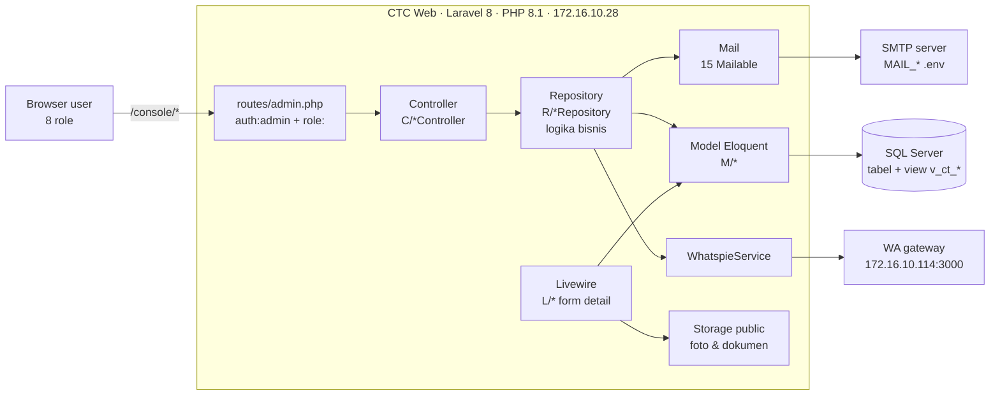

## 2. Alur request

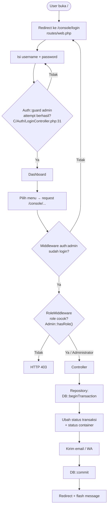

> Administrator selalu lolos cek role (`M/Admin.php:50`). Beberapa route **tidak** punya middleware `role` (Lokasi selain index, Report, hapus detail inspeksi, update progress BAST 2).

## 3. Alur proses end-to-end

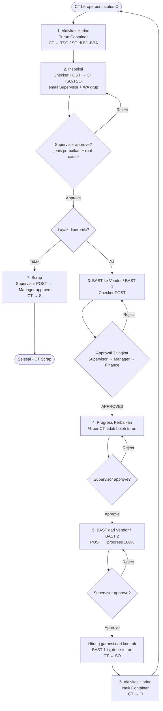

> Catatan: secara kode, BAST 2 dan Progress bisa dibuat setelah BAST 1 berstatus **≠ DRAFT** (belum harus APPROVE3).

## 4. Status container

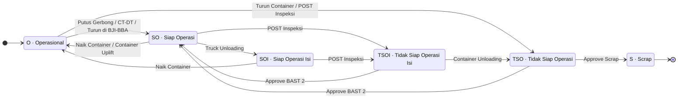

| Kode | Warna dashboard | Diubah di |
|---|---|---|
| O / SO / SOI / TSO / TSOI | `#FFFFFF` / `#FFFF00` / `#F5E342` / `#F4B083` (Maint.), `#C55A11` (Upgrade) / `#BCC9AB` | `R/ContainerDailyActivityRepository.php:26` (posted) |
| TSO / TSOI | | `R/InspectionRepository.php:61-67` |
| SO | | `R/ContainerDelegationFromVendorRepository.php:166-178` |
| S | `#FF0000` | `R/ContainerScrapRepository.php:129-131` |

Semua perubahan lewat `Container::updateStatusByCode()` (`M/Container.php:89`).

## 5. Pola status transaksi

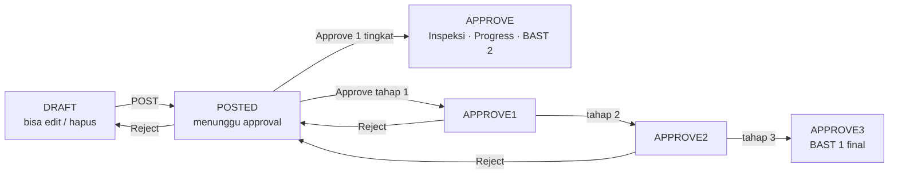

`app/Enums/StatusEnum.php` · Aktivitas Harian berhenti di **POSTED** (tanpa approval).

## 6. BP-02 Aktivitas harian

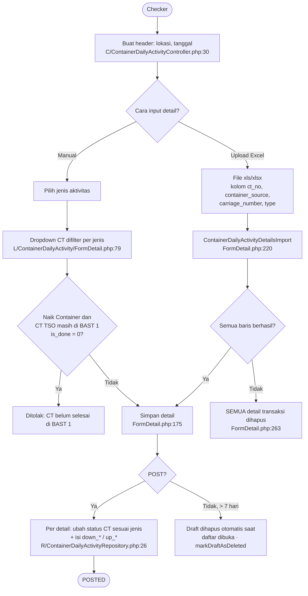

| Jenis aktivitas | CT yang boleh dipilih | Status setelah POST |
|---|---|---|
| Turun Container | TSO (BJI/BBA: O, TSO) | TSO, atau SO di lokasi id 2/3 |
| Naik Container | SO, TSO, SOI | SO/SOI → O, TSO tetap TSO |
| Putus Gerbong | O | SO |
| CT-DT | SO, O | SO |
| Truck Unloading | SO | SOI |
| Container Uplift | SO | O |
| Container Unloading | TSOI | TSO |

## 7. BP-03 Inspeksi

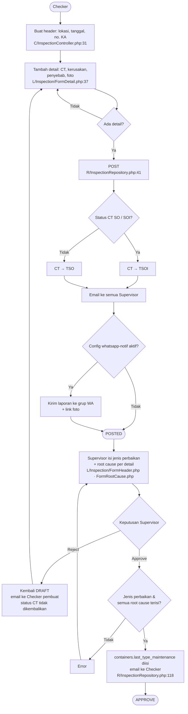

## 8. BP-04 BAST ke Vendor (BAST 1)

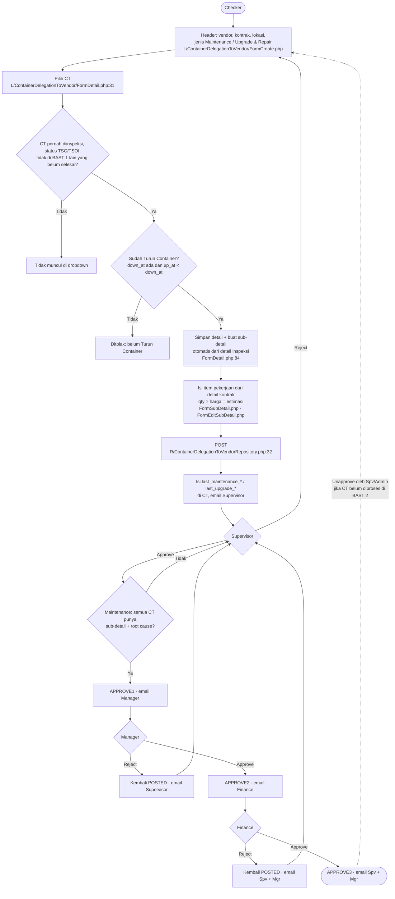

> ⚠ Bug: kondisi `role == 'Administrator' || role == 'X' && status == …` membuat Administrator selalu masuk cabang **APPROVE1** (`ContainerDelegationToVendorRepository.php:158`). Reject menghapus tanggal & vendor maintenance/upgrade di CT.

## 9. BP-05 Progress perbaikan

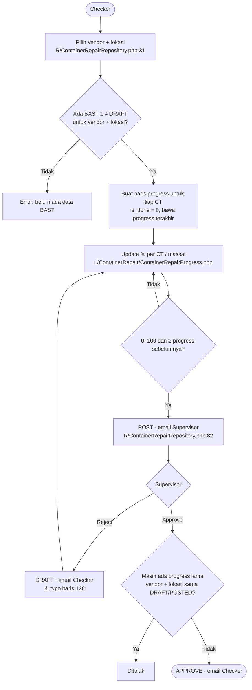

## 10. BP-06 BAST dari Vendor (BAST 2) & garansi

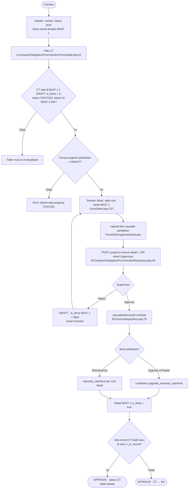

**Rumus garansi:** `akhir = tanggal BAST 2 + warranty_in_days` hari; jika kosong `+ warranty_in_month` bulan (dari kontrak BAST 1).

## 11. BP-07 Scrap

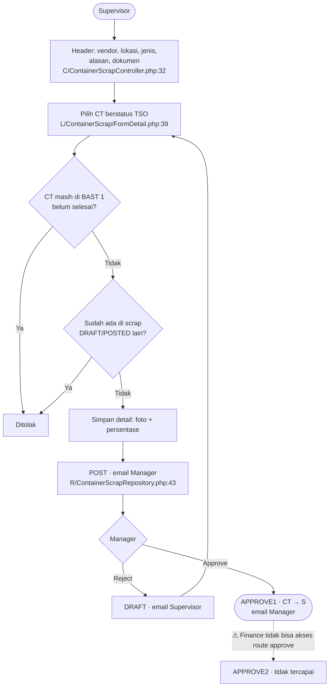

## 12. Notifikasi email & WhatsApp

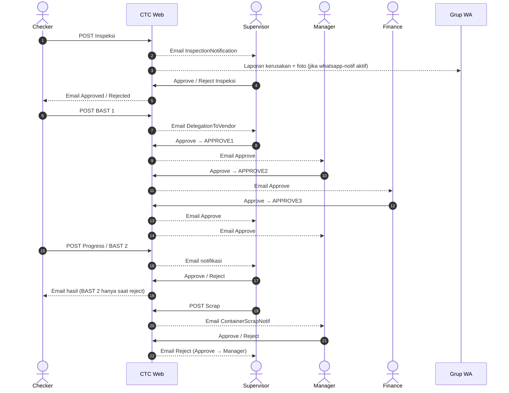

> Semua Mailable `ShouldQueue`, tetapi `.env.example` memakai `QUEUE_CONNECTION=sync`, sehingga email dikirim langsung di dalam DB transaction. SMTP gagal = POST/approve gagal.

## 13. Dashboard & cek layanan WhatsApp

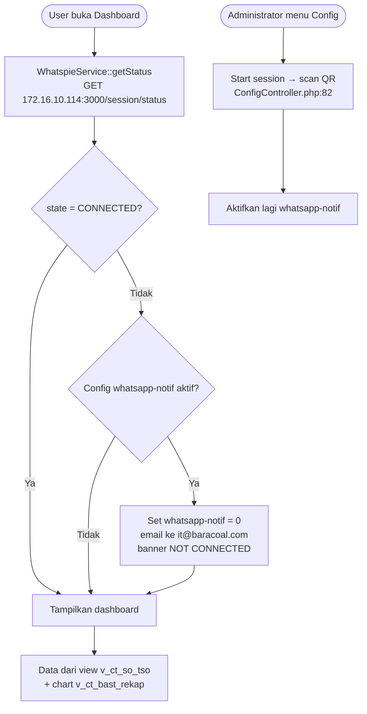

> Dashboard error 500 jika baris config `whatsapp-notif` tidak ada (`C/DashboardController.php:30`).

## 14. Deploy

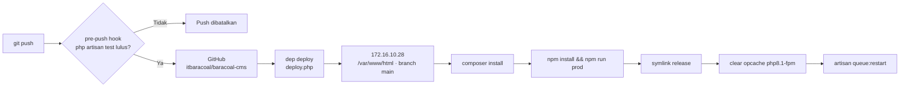

> Tidak ada scheduler: `app/Console/Kernel.php` → `schedule()` kosong.

## 15. Ringkasan file per proses

| Proses | Route (`routes/admin.php`) | Controller | Repository | Livewire |
|---|---|---|---|---|
| Login | `:36-37` | `C/Auth/LoginController.php` | – | – |
| Master data | `:50-165`, `:195-229` | `C/Master/*Controller.php` | `R/*Repository.php` | `L/Container/WarrantyModal.php` |
| Aktivitas harian | `:231-250` | `C/ContainerDailyActivityController.php` | `R/ContainerDailyActivityRepository.php` | `L/ContainerDailyActivity/*` |
| Inspeksi | `:170-192` | `C/InspectionController.php` | `R/InspectionRepository.php` | `L/Inspection/*` |
| BAST 1 | `:253-288` | `C/DelegationToVendorController.php` | `R/ContainerDelegationToVendorRepository.php` | `L/ContainerDelegationToVendor/*` |
| Progress | `:291-312` | `C/ContainerRepairController.php` | `R/ContainerRepairRepository.php` | `L/ContainerRepair/ContainerRepairProgress.php` |
| BAST 2 | `:345-379` | `C/DelegationFromVendorController.php` | `R/ContainerDelegationFromVendorRepository.php` | `L/ContainerDelegationFromVendor/*` |
| Scrap | `:315-342` | `C/ContainerScrapController.php` | `R/ContainerScrapRepository.php` | `L/ContainerScrap/*` |
| Report | `:383-396` | `C/Report/*Controller.php` | `R/CTCReportRepository.php`, `R/BastReportRepository.php` | `L/Report/*`, `L/ContainerDashboard/*` |
| Dashboard & WA | `:40` | `C/DashboardController.php`, `C/Master/ConfigController.php` | `app/Services/WhatspieService.php` | `L/Dashboard/*`, `L/WAService/*` |

Nomor baris mengacu pada source saat dokumen ini disusun dan bisa bergeser jika kode diubah.
