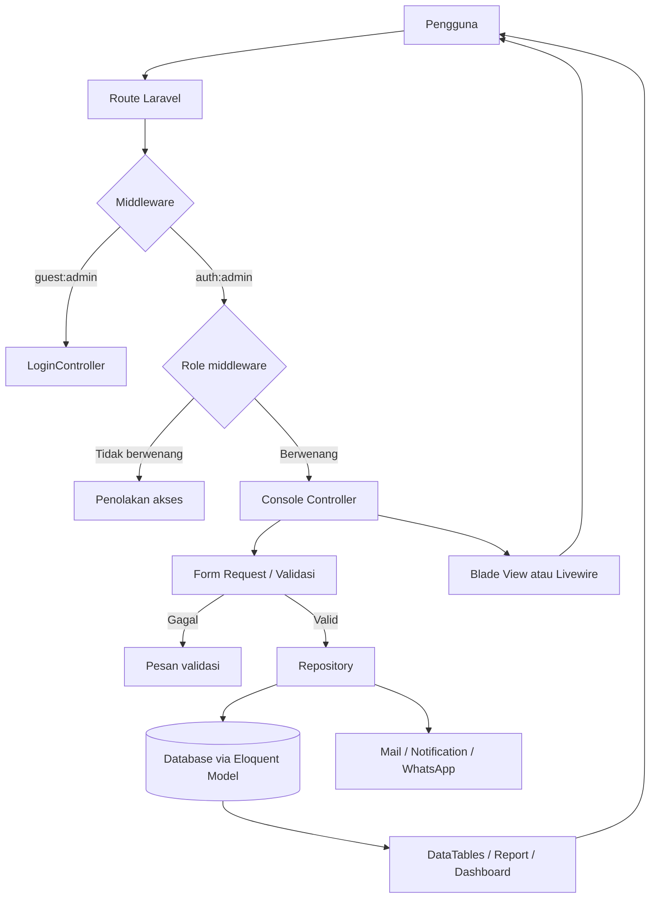
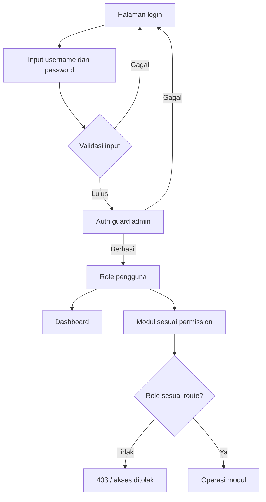
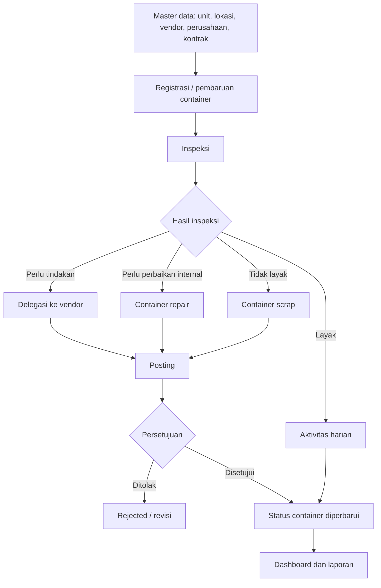

# Dokumentasi Baracoal CMS

## 1. Gambaran Umum

Baracoal CMS adalah aplikasi web berbasis **Laravel 8**, PHP 7.3/8.x, Blade, Livewire, Eloquent ORM, dan Yajra DataTables. Aplikasi digunakan untuk mengelola siklus hidup container, mulai dari master data, inspeksi, aktivitas harian, pengiriman ke vendor, perbaikan, scrap, sampai pelaporan.

Komponen utama:

- **Routing**: [`routes/admin.php`](routes/admin.php), [`routes/web.php`](routes/web.php), dan [`routes/api.php`](routes/api.php).
- **Controller**: [`app/Http/Controllers/Console/`](app/Http/Controllers/Console/).
- **Repository**: [`app/Repositories/Console/`](app/Repositories/Console/).
- **Model**: [`app/Models/`](app/Models/).
- **Validasi request**: [`app/Http/Requests/`](app/Http/Requests/).
- **Komponen interaktif**: [`app/Http/Livewire/`](app/Http/Livewire/).
- **Notifikasi email**: [`app/Mail/`](app/Mail/) dan [`app/Notifications/`](app/Notifications/).
- **Database**: migration pada [`database/migrations/`](database/migrations/).

## 2. Flowchart Arsitektur Aplikasi

Alur request normal:

1. Pengguna mengakses halaman atau mengirim form.
2. Laravel mencocokkan URL dengan route.
3. Middleware memeriksa autentikasi dan role.
4. Controller menerima request dan model hasil route binding.
5. Form Request memvalidasi data jika operasi memerlukan input.
6. Controller meneruskan operasi bisnis ke Repository.
7. Repository membaca atau mengubah database, kemudian dapat mengirim notifikasi.
8. Controller mengembalikan view, redirect, atau hasil DataTables.

## 3. Flowchart Login dan Hak Akses

Guard admin ditangani oleh [`Auth/LoginController.php`](app/Http/Controllers/Console/Auth/LoginController.php). Route yang membutuhkan sesi menggunakan `auth:admin`, sedangkan izin fitur menggunakan middleware `role`.

Role yang digunakan pada route:

- `Administrator`
- `Checker`
- `Supervisor`
- `Manager`
- `Finance`
- `Finance Staff`
- `Purchasing`
- `Site Manager`

## 4. Flowchart Siklus Data Container

Status detail dapat berbeda antar-modul, tetapi pola umumnya adalah **draft -> posted -> approved/rejected**. Perubahan status dilakukan oleh Repository agar aturan bisnis dan efek samping seperti notifikasi tetap terpusat.

## 5. Modul dan Fungsi Controller

### 5.1 Autentikasi dan akses

| Controller | Fungsi |
|---|---|
| `Auth\LoginController` | `showLoginForm()` menampilkan login; `authenticated()` memproses login admin; `logout()` mengakhiri sesi; `guard()` mengambil guard admin. |
| `AccessController` | `profilePassword()` menampilkan halaman ubah password; `changePassword()` memvalidasi dan menyimpan password baru. |
| `DashboardController` | `index()` menampilkan dashboard; `downloadUserManual()` mengunduh manual pengguna. |

### 5.2 Master data

Controller master berada di [`app/Http/Controllers/Console/Master/`](app/Http/Controllers/Console/Master/).

| Controller | Fungsi utama |
|---|---|
| `AdminController` | CRUD akun admin: `index`, `create`, `store`, `show`, `edit`, `update`, `destroy`. |
| `CompanyController` | CRUD perusahaan: `index`, `create`, `store`, `show`, `edit`, `update`, `destroy`. |
| `ConfigController` | CRUD konfigurasi dan kontrol sesi WhatsApp: `index`, `create`, `store`, `show`, `edit`, `update`, `destroy`, `start_session`, `terminate_session`. |
| `ContainerController` | CRUD container: `index`, `create`, `store`, `show`, `edit`, `update`, `destroy`. |
| `ContractController` | CRUD kontrak: `index`, `create`, `store`, `edit`, `update`, `destroy`. |
| `ContractDetailController` | CRUD detail kontrak: `index`, `create`, `store`, `edit`, `update`, `destroy`. |
| `LocationController` | CRUD lokasi: `index`, `create`, `store`, `show`, `edit`, `update`, `destroy`. |
| `UnitController` | CRUD unit: `index`, `create`, `store`, `show`, `edit`, `update`, `destroy`. |
| `VendorController` | CRUD vendor: `index`, `create`, `store`, `show`, `edit`, `update`, `destroy`. |

### 5.3 Operasional container

| Controller | Fungsi utama |
|---|---|
| `InspectionController` | Membuat dan mengubah inspeksi (`index`, `create`, `store`, `detail`, `edit`, `update`), menghapus detail (`detailDestroy`), mem-posting (`posted`), menghapus draft (`destroy`), serta `approve` dan `reject`. |
| `ContainerDailyActivityController` | Mengelola aktivitas harian (`index`, `create`, `store`, `detail`, `edit`, `update`, `destroy`, `posted`) dan unggah detail (`upload`). |
| `DelegationToVendorController` | Mengelola delegasi ke vendor: CRUD header, detail, sub-detail, `posted`, `approve`, `reject`, `unapprove`, `detailDelete`, `subDetailDestroy`, dan `duplicateSubDetail`. |
| `DelegationFromVendorController` | Menerima hasil delegasi vendor: CRUD header, detail, sub-detail, `posted`, `approve`, `reject`, `detailDestroy`, `duplicateSubDetail`, dan `updateProgress`. |
| `ContainerRepairController` | Mengelola perbaikan: `index`, `create`, `store`, `show`, `edit`, `update`, `destroy`, `posted`, `approve`, `reject`. |
| `ContainerScrapController` | Mengelola scrap: `index`, `create`, `store`, `detail`, `edit`, `update`, `destroy`, `posted`, `approve`, `reject`, dan `detailDestroy`. |

### 5.4 Laporan

| Controller | Fungsi |
|---|---|
| `ContainerDashboardController` | `index()` menampilkan dashboard statistik container. |
| `ContainerStatusReportController` | `index()` menampilkan laporan status container. |
| `ContainerRecordController` | `index()` menampilkan histori atau record container. |
| `BastReportController` | `maintenance()`, `upgrade()`, dan `inspection()` menampilkan laporan BAST berdasarkan jenis pekerjaan. |

## 6. Fungsi Repository

Repository berada di [`app/Repositories/Console/`](app/Repositories/Console/) dan menjadi lapisan operasi database serta aturan bisnis.

| Repository | Fungsi |
|---|---|
| `AdminRepository` | `store`, `update`, `destroy`, `changePassword`. |
| `CompanyRepository` | `store`, `update`, `destroy`. |
| `ConfigRepository` | `store`, `update`, `destroy`. |
| `LocationRepository` | `store`, `update`, `destroy`. |
| `UnitRepository` | `store`, `update`, `destroy`. |
| `VendorRepository` | `store`, `update`, `destroy`. |
| `ContainerRepository` | `store`, `dataTableQuery`, `update`, `destroy`. |
| `ContractRepository` | `store`, `update`, `destroy`, `calculateWarrantyFromDate`. |
| `ContractDetailRepository` | `store`, `update`, `destroy` untuk detail kontrak. |
| `InspectionRepository` | `store`, `posted`, `update`, `approve`, `reject`, `detailDestroy`, `getDataTableQuery`, `set_group_notif`. |
| `ContainerDailyActivityRepository` | `store`, `posted`, `update`, `destroy`, `markDraftAsDeleted`. |
| `ContainerDelegationToVendorRepository` | `store`, `posted`, `update`, `destroy`, `approve`, `reject`, `unapprove`, `subDetailDestroy`, `getDataTableQuery`, `duplicateSubDetail`, `detailDelete`. |
| `ContainerDelegationFromVendorRepository` | `store`, `posted`, `update`, `destroy`, `approve`, `reject`, `getDataTableQuery`, `updateProgress`, `detailDestroy`, `duplicateSubDetail`. |
| `ContainerRepairRepository` | `store`, `posted`, `update`, `destroy`, `reject`, `approve`, `getDataTableQuery`. |
| `ContainerScrapRepository` | `store`, `posted`, `update`, `destroy`, `approve`, `reject`, `getDataTableQuery`, `detailDelete`, `detailDestroy`. |
| `BastReportRepository` | Query laporan maintenance (`getDataTableMaintenanceQuery`), upgrade (`getDataTableUpgradeQuery`), dan inspeksi (`getDataInspection`). |
| `CTCReportRepository` | `getColors`, `getStatusDashboardQuery`, dan `getFilteringContainerQuery` untuk dashboard dan filter laporan. |
| `RootCauseListRepository` | Menyediakan daftar root cause untuk form inspeksi/delegasi. |

## 7. Livewire dan Fungsi Interaktif

Komponen Livewire pada [`app/Http/Livewire/`](app/Http/Livewire/) menangani form dan tabel tanpa reload penuh:

- `Dashboard`: grafik, modal detail, filter lokasi/status, serta isi tabel dashboard.
- `Container`: modal warranty container.
- `ContainerDailyActivity`: form detail, upload dokumen/gambar, perubahan tipe/container, dan tabel detail.
- `Inspection`: header, detail, root cause, modal edit, dan tabel detail inspeksi.
- `ContainerDelegationToVendor`: form create/edit, detail, sub-detail, kalkulasi quantity/harga, root cause, dan duplikasi sub-detail.
- `ContainerDelegationFromVendor`: detail serta edit sub-detail dan gambar.
- `ContainerRepair`: progress perbaikan.
- `ContainerScrap`: form dan tabel detail scrap.
- `Report`: filter BAST, laporan inspeksi, container report, dan container record.
- `WAService`: tombol aksi dan modal QR Code WhatsApp.

Method Livewire yang umum:

- `mount()` menginisialisasi data berdasarkan parameter route.
- `render()` memilih view Livewire.
- `submit()` menyimpan form.
- `updated<Property>()` bereaksi terhadap perubahan field dan memperbarui pilihan atau kalkulasi.
- `openModal()` / `closeModal()` mengatur modal.
- `upload()` menangani unggah file.
- `export()` mengekspor data laporan.

## 8. Service, Helper, Mail, dan Event

### Service dan helper

- [`WhatspieService.php`](app/Services/WhatspieService.php): `startSession()`, `getStatus()`, `terminateSession()`, `fetchQRCode()`, dan `sendMessageToGroup()` untuk integrasi WhatsApp.
- [`Helper.php`](app/Services/Helper.php): `rand_color()` menghasilkan warna acak untuk kebutuhan visualisasi.
- [`DateHelper.php`](app/Helper/DateHelper.php): fungsi bantu pemrosesan tanggal.
- [`File.php`](app/Helper/File.php): fungsi bantu pengelolaan file.

### Mail dan notifikasi

Folder [`app/Mail/`](app/Mail/) berisi notifikasi email untuk inspeksi, progress, delegasi, scrap, dan WhatsApp. Pola umumnya:

1. Repository mengubah status transaksi.
2. Repository atau controller membuat Mail/Notification.
3. Laravel mengirim email atau notifikasi kepada pihak terkait.

### Event

- [`InspectionDetailCreated.php`](app/Events/InspectionDetailCreated.php) dipicu saat detail inspeksi dibuat dan dapat digunakan untuk proses lanjutan/notifikasi.

## 9. Model dan Data Utama

Model Eloquent berada di [`app/Models/`](app/Models/). Entitas utama:

- **Master**: `Admin`, `Company`, `Location`, `Unit`, `Vendor`, `Config`.
- **Kontrak**: `Contract`, `ContractDetail`, `ContractType`.
- **Container**: `Container`, `ContainerStatus`, `ContainerDocument`, `Record`.
- **Inspeksi**: `Inspection`, `InspectionDetail`, `Condition`.
- **Aktivitas**: `ContainerDailyActivity`, `ContainerDailyActivityDetail`.
- **Delegasi**: `ContainerDelegation`, `ContainerDelegationDetail`, `ContainerDelegationSubDetail`, `ContainerDelegationFromVendor`, `ContainerDelegationFromVendorDetail`, `ContainerDelegationFromVendorSubDetail`.
- **Perbaikan dan scrap**: `ContainerRepair`, `ContainerRepairDetail`, `ContainerScrap`, `ContainerScrapDetail`.
- **Dashboard**: `Dashboard`.

Database dibentuk oleh migration pada [`database/migrations/`](database/migrations/). Migration utama mencakup tabel admin, vendor, company, location, unit, contract, container, inspection, aktivitas harian, delegasi, repair, scrap, notification, dan jobs.

## 10. Konvensi Operasional

- Gunakan **Form Request** untuk validasi input pengguna.
- Gunakan **Repository** untuk query dan perubahan data bisnis; hindari menaruh query kompleks langsung di view.
- Gunakan **route model binding** pada parameter seperti `{container}`, `{inspection}`, dan `{contract}`.
- Batasi operasi berdasarkan `auth:admin` dan middleware `role`.
- Operasi persetujuan sebaiknya dilakukan setelah data di-posting.
- Data tabel besar ditampilkan melalui DataTables agar pagination dan filter diproses secara efisien.
- Perubahan status transaksi perlu mempertahankan konsistensi antara model, detail, notifikasi, dan histori.

## 11. Referensi Route

- Route publik dan redirect awal: [`routes/web.php`](routes/web.php).
- Route console/admin: [`routes/admin.php`](routes/admin.php).
- Route API: [`routes/api.php`](routes/api.php).
- Route channel broadcast: [`routes/channels.php`](routes/channels.php).

Dokumentasi ini dibuat dari struktur dan method yang tersedia pada source code saat ini. Jika ada controller atau route baru, tambahkan ke bagian modul terkait agar dokumentasi tetap sinkron.
